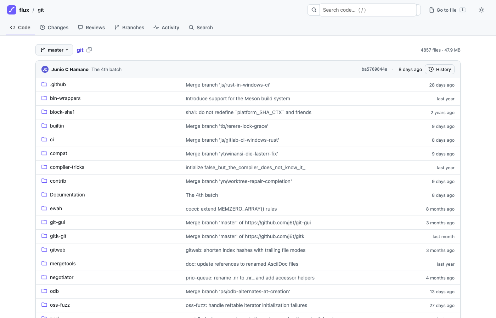
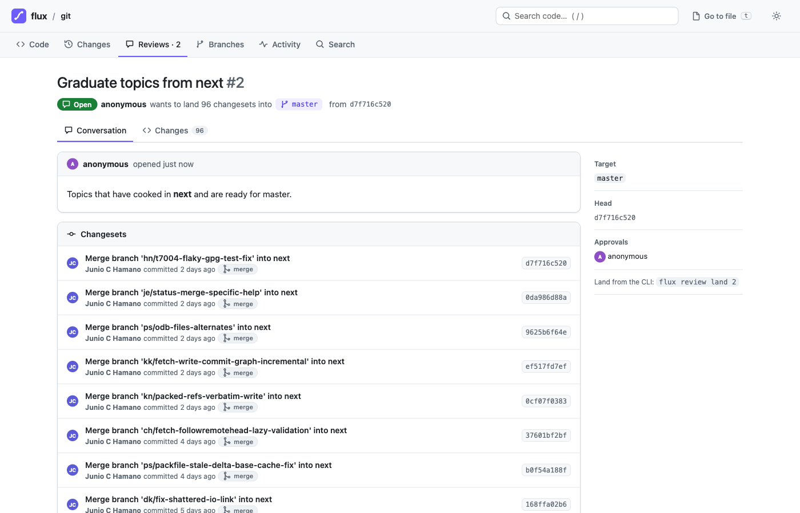
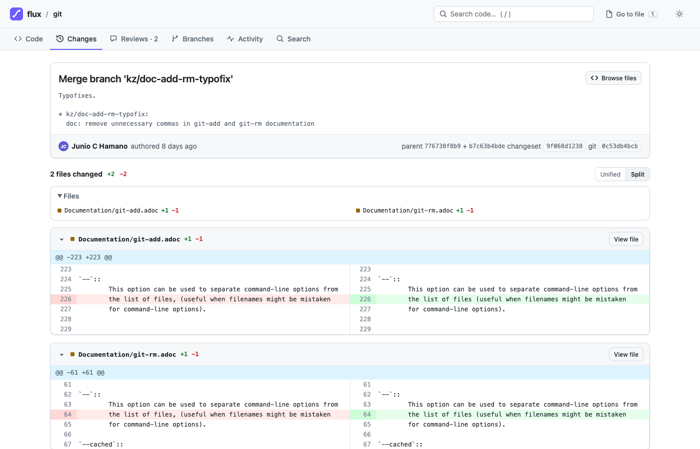
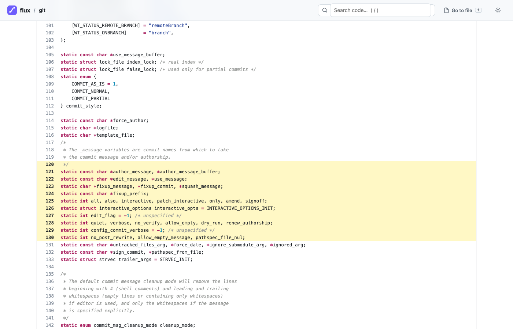
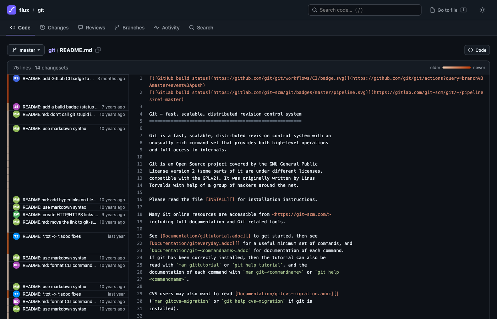

# flux

**Source control for huge monorepos and agent-heavy write workloads.** flux is an open-source take on the ideas behind Anthropic's Scion ([Redesigning source control](https://www.anthropic.com/engineering/redesigning-source-control)), Meta's Mononoke/EdenFS and Google's Piper:

- **The server owns history.** Clients never download the whole repository; sparse working copies, server-side log/diff/blame/search, and landing all happen on the server.
- **Changesets are deltas.** Creating one costs O(change), not O(repo). Trees, history indexes and blame are *derived data*.
- **Everything is content-addressed** (BLAKE3, domain separated) and verified on every fetch, by every tier.
- **Refs move only by compare-and-swap**, and **landing is a server-side rebase** with line-level three-way merges, so many people and agents can land on `main` concurrently without a merge queue lock.
- **Git compatible from day one:** import any git repository (incremental and resumable) and verify the result against `git ls-tree`.

It ships as one binary for the server, gRPC API and web UI (`flux-server`), one CLI (`flux`) and a git importer (`flux-import-git`).



| | |
|---|---|
|  |  |
|  |  |

## Speed

Measured on an M-series laptop, git.git imported (85,558 changesets, 4,857 files at `master`), release build, SQLite + local segments unless noted:

| Operation | Time |
|---|---|
| Web: repository home, directory listing with last-commit per entry | **1–3 ms** server time (warm) |
| Web: 3,000-line file, syntax highlighted | 2–9 ms warm; first view capped at ~50 ms (highlighting finishes in the background) |
| Web: history of one file (`commits/master/builtin/commit.c`) | 5 ms |
| Web: code search over the whole tree (`strbuf_addf`) | 7 ms warm, 330 ms cold |
| CLI: `flux status` on 4,857 files | 3–11 ms |
| CLI: `flux commit` (upload + create + CAS) | ~20 ms |
| CLI: full checkout, 4,857 files / 48 MB | 350 ms |
| Land with server-side rebase + three-way merge | ~10 ms |
| git import, git.git, full history | 73 s (1,174 commits/s), SQLite or Postgres |
| Storage for git.git | 416 MB blobs + 190 MB metadata (git's pack: 334 MB) |

Every page shows its render time in the footer and in a `Server-Timing` header.

## Quick start

```sh
cargo build --release
export PATH="$PWD/target/release:$PATH"

# All-in-one server: SQLite + local segment files, web UI on the same port.
flux-server --data-dir ./data --create-repo demo &
open http://127.0.0.1:7878

# Import a git repository (resumable, incremental), then check it.
flux-import-git --repo demo import /path/to/repo.git
flux-import-git --repo demo verify /path/to/repo.git --sample 200

# Or start from scratch.
flux attach 127.0.0.1:7878 demo work && cd work
echo hello > README.md
flux commit -A -m "First commit" && flux branch main
```

### A day with the CLI

```sh
flux attach 127.0.0.1:7878 demo app --sparse services/api   # sparse by default
flux status                      # parallel stat; honours .gitignore/.fluxignore
flux diff                        # working copy vs parent
flux commit -m "Fix retry loop"  # advances the followed branch by CAS
flux branch feature/retry        # create + follow a branch
flux review create --target main # open a code review for the stack
flux review land 7               # server-side rebase + three-way merge + CAS
flux land --onto main            # or land directly, no review
flux sync                        # fast-forward to the branch's latest

# No checkout needed for any of these:
flux log builtin/commit.c        # file history (indexed, not a full scan)
flux blame src/lib.rs
flux grep -i "todo" src/         # server-side search
flux find cmtc                   # fuzzy file finder
flux cat main~3 Makefile
flux show @ --stat
flux watch                       # live ref moves and review activity
flux web                         # open this file/directory in the browser
```

### The web UI

Served by `flux-server` on the same port as gRPC (HTTP/1.1 and HTTP/2):

- **Code:** tree browser with the last change per entry, README rendering, syntax highlighting, line and range links (`#L10-L20`), raw, blame with age heat-map, file history, permalinks (`y`).
- **Changes:** history grouped by day, changeset pages with unified or split diffs, compare views (`/-/compare/main...feature`).
- **Reviews:** open, comment, approve, close, and **land** from the browser. flux tells you whether landing is a fast-forward or a rebase and reports real conflicts.
- **Search** across the whole tree with regex, case and path filters. **Go to file** (`t`) is a fuzzy finder over every path.
- **Branches** with ahead/behind counts, **Activity** (every ref move, updated live over server-sent events).
- **Keyboard:** `t` finder, `/` search, `y` permalink, `Esc`. Light and dark themes.
- Links are prefetched on hover and pages swap in place, so navigation feels instant.

## Production

```sh
# Postgres metadata + S3-compatible blobs (S3, R2, MinIO via AWS_ENDPOINT).
flux-server --meta-url postgres://flux@db/flux --blob-url s3://bucket/flux --auth token

# Or the whole stack with Docker: Postgres + MinIO + flux.
docker compose up -d
docker compose exec flux flux-server token --user admin --admin
```

- **Auth** (`--auth`): `open` (single user / trusted network), `token` (anonymous reads, token writes), `private` (tokens for everything). `flux-server token --user NAME [--admin]` issues a token; only its SHA-256 is stored. `flux login` saves it for the CLI; the web UI uses an HttpOnly, SameSite cookie. `flux-server revoke --user NAME` revokes.
- **Durability:** objects are fsynced before any metadata references them. Segment files are append-only with per-record CRCs, and a torn tail is truncated on restart. The importer resumes after any crash. A test kills the server with `SIGKILL` three times during a git.git import, then resumes, verifies and runs `fsck --full`.
- **Integrity:** `flux-server fsck [--full]` re-hashes changesets, trees and file contents, checks graph closure and refs, and re-derives missing derived data. It is safe to run online.
- **Backups:** `flux-server backup DIR` takes a consistent online snapshot of the all-in-one layout (metadata first, then append-only blobs). Restore with `flux-server --data-dir DIR`. For Postgres use `pg_dump` or PITR; for S3, bucket versioning.
- **Caching tier:** `flux-server cache --upstream http://primary:7878 --dir /var/cache/flux` is a regional cache (SPEC §9.2). It serves verified trees and contents from local disk and proxies everything else, web UI included. Clients point at it exactly as they would at the server.
- **Observability:** Prometheus metrics at `/-/metrics` (request counts and latency histograms per surface, blob stats), `/-/healthz`, `/-/readyz` and `Server-Timing` on every response. The server shuts down gracefully on SIGTERM.
- **Web security:** strict CSP (no inline scripts, no third-party code), escaped and sanitized repository Markdown, and raw files served sandboxed with `nosniff`. Same-origin checks run on every form POST.

## Architecture

```
 flux CLI ─┐                        ┌─ flux-server ─ SQLite or Postgres (changesets, refs, reviews, derived ids)
 browsers ─┼─ gRPC + HTTP ─► (cache)┤               └ segment files or S3 (trees, contents; deltas + chunks)
 agents  ──┘                        └─ web UI, events, landing, history indexes
```

| Crate | What it does |
|---|---|
| `flux-core` | ids, deterministic CBOR, paths, changesets, trees; golden vectors pin object identity |
| `flux-store` | metadata stores (SQLite, Postgres; one conformance suite), blob store: segment files with delta chains and FastCDC chunking, or any object store |
| `flux-derive` | `tree_v1` and `lastmod_v1` derivation, tree walk and diff |
| `flux-server` | core operations, commit graph, landing, reviews, search, auth, gRPC, web UI, cache tier, fsck and backup |
| `flux-client` | Rust client; verifies every object it fetches |
| `flux-cli` | the `flux` command |
| `flux-git` | `flux-import-git` (import and verify) |

The full design, with the deviations implemented so far, is in [`docs/SPEC.md`](docs/SPEC.md).

## Development

```sh
cargo test --workspace
FLUX_TEST_POSTGRES_URL=postgres://localhost/flux_test cargo test -p flux-store   # Postgres conformance
FLUX_BLESS=1 cargo test -p flux-core --test golden                               # only for format changes
```

`protoc` is vendored, so no system install is needed.

**Not done yet:** path-level ACL domains, the git smart-HTTP frontend, the virtual filesystem (phase 4), trained zstd dictionaries and Windows support (untested).

## License

Apache-2.0
